# PokéAPI Sprites <a href="https://pokeapi.co/api/v2/pokemon/smeargle"></a>

To save load on PokéAPI, we host all the sprite images here.
If you want to use all the sprites in your application, you can just download the entire contents directly.

## Install

### Git

```sh
git clone https://github.com/PokeAPI/sprites.git
```

### Npm

```sh
npm install --save github:PokeAPI/sprites
```

### Bower

```sh
bower install --save PokeAPI/sprites
```

## Sprites

The sprites are divided in the different subfolders you can see below.

```
sprites
\- pokemon
    \- other
        \- dream world (SVGs)
        \- official artwork (PNGs)
        \- showdown (GIFs)
        \- home (PNGs with female, shiny, and shiny-female variants)
    \- versions
        \- generation i
            \- red and green (PNGs with back, gray, back-gray variants)
            \- red and blue (PNGs with back, gray, transparent, transparent-gray, back-transparent, back-transparent-gray, back-gray variants)
            \- yellow (PNGs with back, gbc, gray, transparent, transparent-gray, back-gbc, back-gray, back-transparent, back-transparent-gray variants)
        \- generation ii
            \- crystal (PNGs with back, shiny, back-shiny, transparent, transparent-shiny, back-transparent, back-transparent-shiny variants)
                \- animated (GIFs of front-facing battle entrance sprites with shiny variants)
            \- gold (PNGs with back, shiny, transparent, back-shiny, transparent-shiny, back-transparent, back-transparent-shiny variants)
            \- silver (PNGs with back, shiny, transparent, back-shiny, transparent-shiny, back-transparent, back-transparent-shiny variants)
        \- generation iii
            \- emerald (PNGs with front, back, shiny, back-shiny, and animated variants)
            \- fire red and leaf green (PNGs with front, back, shiny, back-shiny variants)
            \- ruby and sapphire (PNGs with front, back, shiny, back-shiny variants)
            \- icons (PNGs)
        \- generation iv
            \- diamond and pearl (PNGs with back, female, shiny, back-female, back-shiny, shiny-female, and animated front variants)
            \- heart gold and soul silver (PNGs with back, female, shiny, back-female, back-shiny, shiny-female, and animated front variants)
            \- platinum (PNGs with back, female, shiny, back-female, back-shiny, shiny-female, and animated front variants)
            \- icons (PNGs)
        \- generation v
            \- black and white (PNGs with static and animated back, female, shiny, back-female, back-shiny, shiny-female variants)
            \- icons (PNGs with animated variants)
        \- generation vi
            \- omega ruby and alpha sapphire (PNGs with back, female, shiny, back-female, back-shiny, shiny-female variants)
            \- x and y (PNGs with back, female, shiny, back-female, back-shiny, shiny-female variants)
            \- icons (PNGs with female variants)
        \- generation vii
            \- ultra sun and ultra moon (GIFs with back, female, shiny, back-female, back-shiny, shiny-female variants)
            \- lets go pikachu and lets go eevee (GIFs with back, female, shiny, back-female, back-shiny, shiny-female variants and PNG icons)
            \- icons (PNGs with female variants)
        \- generation viii
            \- sword and shield (WebPs with back, female, shiny, back-female, back-shiny, shiny-female variants and PNG icons with female variants)
            \- brilliant diamond and shining pearl (WebPs with back, female, shiny, back-female, back-shiny, shiny-female variants and PNG icons)
            \- legends arceus (WebPs with back, female, shiny, back-female, back-shiny, shiny-female variants and PNG icons with female and shiny variants)
        \- generation ix
            \- scarlet and violet (WebPs with back, female, shiny, back-female, back-shiny, shiny-female variants and PNG icons with female variants)
            \- legends z-a (WebPs with back, female, shiny, back-female, back-shiny, shiny-female variants and PNG icons with female and shiny variants)
            \- champions (WebPs with back, female, shiny, back-female, back-shiny, shiny-female variants and PNG icons with shiny variants)
    \- default PokeAPI sprites (PNGs with back, female, shiny, back-female, back-shiny, shiny-female variants)
\- items
    \- default PokeAPI items (PNGs)
\- types
    \- generation iii (PNGs for colosseum, emerald, firered-leafgreen, ruby-sapphire, xd)
    \- generation iv (PNGs for diamond-pearl, heartgold-soulsilver, platinum)
    \- generation v (PNGs for black-white, black-2-white-2)
    \- generation vi (PNGs for x-y, omega-ruby-alpha-sapphire)
    \- generation vii (PNGs for sun-moon, ultra-sun-ultra-moon, lets-go-pikachu-lets-go-eevee with small symbol variants)
    \- generation viii (PNGs for sword-shield, brilliant-diamond-shining-pearl, legends-arceus with small symbol variants)
    \- generation ix (PNGs for scarlet-violet with small symbol and Tera variants, and champions with small symbol variants)
```

> All the following images are embedded at a maximum 100x100px size. All the smaller ones preserve their size while the bigger ones are embedded at 100x100px.

### `pokemon`

Interested in helping us complete the default Gen 5 style sprite collection? See [CONTRIBUTING_SPRITES.md](./CONTRIBUTING_SPRITES.md) for details on our maintenance scripts for National Dex 650+.

#### `other`

##### `dream-world`

| Front |
| --- |
| SVG |
|  |

##### `home`

| Front | Front shiny | Front female | Front shiny female |
| --- | --- | --- | --- |
| PNG<br>_512x512_ | PNG<br>_512x512_ | PNG<br>_512x512_ | PNG<br>_512x512_ |
| 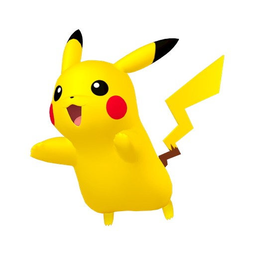 | 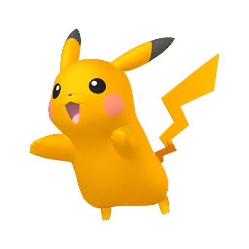 |  | 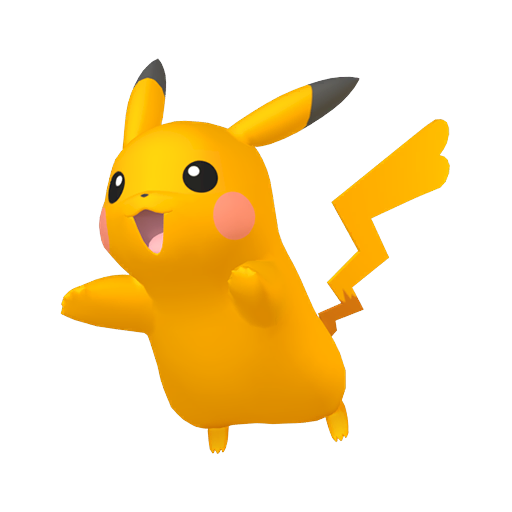 |

##### `official-artwork`

| Front | Front shiny |
| --- | --- |
| PNG<br>_475x475_ | PNG<br>_475x475_ |
| 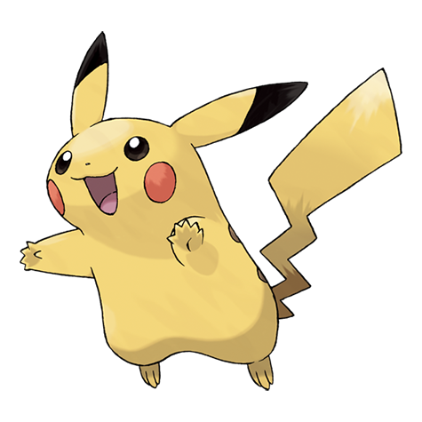 | 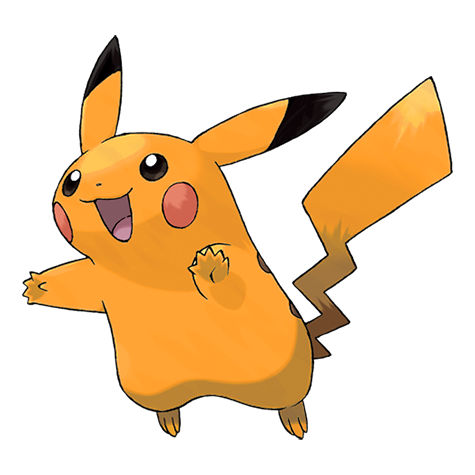 |

This folder contains the custom shiny sprites of the official artwork. We thank [@DevMike123](https://github.com/DevMike123), [@JoseBaGra](https://github.com/JoseBaGra), and Pokétwo who are the spriters that created these custom shiny sprites.

##### `showdown`

| Front | Front shiny | Back | Back shiny |
| --- | --- | --- | --- |
| GIF<br>_varies_ | GIF<br>_varies_ | GIF<br>_varies_ | GIF<br>_varies_ |
| 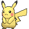 | 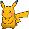 | 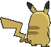 |  |

This folder contains battle animation sprites designed by the [Smogon community](https://www.smogon.com/).

---

#### `versions`

##### `generation i`

###### `red-green-japan`

| Front | Back | Front gray | Back gray |
| --- | --- | --- | --- |
| PNG<br>_56x56_ | PNG<br>_32x32_ | PNG<br>_56x56_ | PNG<br>_32x32_ |
| 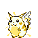 | 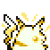 | 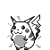 |  |

###### `red-blue`

| Front | Back | Front gray | Front transparent | Back transparent | Back gray | Front transparent gray | Back transparent gray |
| --- | --- | --- | --- | --- | --- | --- | --- |
| PNG<br>_40x40_, _48x48_, _56x56_ | PNG<br>_32x32_ | PNG<br>_40x40_, _48x48_, _56x56_ | PNG<br>_96x96_ | PNG<br>_56x56_ | PNG<br>_32x32_ | PNG<br>_56x56_ | PNG<br>_56x56_ |
| 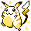 |  | 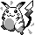 | 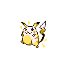 |  | 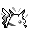 | 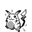 | 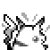 |

###### `yellow`

| Front | Back | Front gbc | Front gray | Front transparent | Front transparent gray | Back gray | Back gbc | Back transparent | Back transparent gray |
| --- | --- | --- | --- | --- | --- | --- | --- | --- | --- |
| PNG<br>_40x40_, _48x48_, _56x56_ | PNG<br>_32x32_ | PNG<br>_40x40_, _48x48_, _56x56_ | PNG<br>_40x40_, _48x48_, _56x56_ | PNG<br>_56x56_ | PNG<br>_56x56_ | PNG<br>_32x32_ | PNG<br>_32x32_ | PNG<br>_96x96_ | PNG<br>_56x56_ |
| 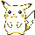 | 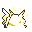 | 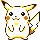 | 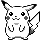 | 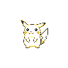 | 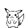 |  | 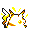 | 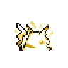 |  |

---

##### `generation ii`

###### `crystal`

| Front | Back | Front shiny | Back shiny | Front transparent | Back transparent | Front shiny transparent | Back shiny transparent | Front animated | Front shiny animated |
| --- | --- | --- | --- | --- | --- | --- | --- | --- | --- |
| PNG<br>_40x40_, _48x48_, _56x56_ | PNG<br>_40x40_ | PNG<br>_40x40_, _48x48_, _56x56_ | PNG<br>_40x40_ | PNG<br>_96x96_ | PNG<br>_96x96_ | PNG<br>_96x96_ | PNG<br>_96x96_ | GIF<br>_56x56_ | GIF<br>_56x56_ |
| 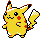 |  | 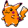 |  | 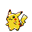 | 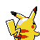 | 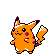 | 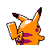 | 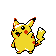 | 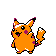 |

###### `gold`

| Front | Back | Front shiny | Front transparent | Back shiny |
| --- | --- | --- | --- | --- |
| PNG<br>_40x40_, _48x48_, _56x56_ | PNG<br>_40x40_ | PNG<br>_40x40_, _48x48_, _56x56_ | PNG<br>_107x107, 80x80_ | PNG<br>_40x40_ |
| 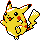 | 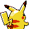 | 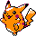 | 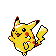 | 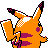 |

###### `silver`

| Front | Back | Front shiny | Front transparent | Back shiny |
| --- | --- | --- | --- | --- |
| PNG<br>_40x40_, _48x48_, _56x56_ | PNG<br>_40x40_ | PNG<br>_40x40_, _48x48_, _56x56_ | PNG<br>_107x107, 80x80_ | PNG<br>_40x40_ |
| 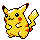 |  | 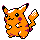 | 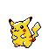 |  |

---

##### `generation iii`

###### `emerald`

| Front | Back | Front shiny | Back shiny |
| --- | --- | --- | --- |
| PNG<br>_64x64_ | PNG<br>_64x64_ | PNG<br>_64x64_ | PNG<br>_64x64_ |
|  |  | 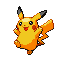 |  |

###### `fire red and leaf green`

| Front | Back | Front shiny | Back shiny |
| --- | --- | --- | --- |
| PNG<br>_64x64_ | PNG<br>_64x64_ | PNG<br>_64x64_ | PNG<br>_64x64_ |
| 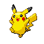 |  | 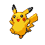 | 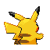 |

###### `ruby and sapphire`

| Front | Back | Front shiny | Back shiny |
| --- | --- | --- | --- |
| PNG<br>_64x64_ | PNG<br>_64x64_ | PNG<br>_64x64_ | PNG<br>_64x64_ |
|  | 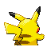 | 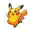 | 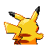 |

###### `icons`

| Menu Icon |
| --- |
| PNG<br>_32x32_ |
| 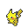 |

---

##### `generation iv`

###### `diamond and pearl`

| Front | Back | Front female | Front shiny | Back female | Back shiny | Shiny female |
| --- | --- | --- | --- | --- | --- | --- |
| PNG<br>_80x80_ | PNG<br>_80x80_ | PNG<br>_80x80_ | PNG<br>_80x80_ | PNG<br>_80x80_ | PNG<br>_80x80_ | PNG<br>_80x80_ |
| 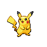 |  |  |  |  |  |  |

###### `heart gold and soul silver`

| Front | Back | Front female | Front shiny | Back female | Back shiny | Shiny female |
| --- | --- | --- | --- | --- | --- | --- |
| PNG<br>_80x80_ | PNG<br>_80x80_ | PNG<br>_80x80_ | PNG<br>_80x80_ | PNG<br>_80x80_ | PNG<br>_80x80_ | PNG<br>_80x80_ |
|  |  |  |  |  |  |  |

###### `platinum`

| Front | Back | Front female | Front shiny | Back female | Back shiny | Shiny female |
| --- | --- | --- | --- | --- | --- | --- |
| PNG<br>_80x80_ | PNG<br>_80x80_ | PNG<br>_80x80_ | PNG<br>_80x80_ | PNG<br>_80x80_ | PNG<br>_80x80_ | PNG<br>_80x80_ |
|  |  |  |  |  |  |  |

###### `icons`

| Menu Icon |
| --- |
| PNG<br>_32x32_ |
|  |

---

##### `generation v`

###### `black and white`

This folder contains the official B&W sprites on top of custom sprites designed by the [Smogon community](https://www.smogon.com/).

- The sprites with IDs greater than 650 are thus not official. You can find the source of these sprites at this [Smogon thread](https://www.smogon.com/forums/threads/sword-shield-sprite-project.3647722/) and also at this [Google Sheet](https://docs.google.com/spreadsheets/d/1acgzAjh0dnFRQnjZu8kSjS177rKCzpFfEHRLtwuuXRU/edit#gid=0). We thank the spriters who contributed custom Gen 5-style sprites.

| Front | Back | Front female | Front shiny | Back female | Back shiny | Shiny female |
| --- | --- | --- | --- | --- | --- | --- |
| PNG<br>_96x96_ | PNG<br>_96x96_ | PNG<br>_96x96_ | PNG<br>_96x96_ | PNG<br>_96x96_ | PNG<br>_96x96_ | PNG<br>_96x96_ |
|  |  |  |  |  |  |  |

Animated Battle Sprites:

| Front | Back | Front female | Front shiny | Back female | Back shiny | Shiny female |
| --- | --- | --- | --- | --- | --- | --- |
| GIF<br>_varies_ | GIF<br>_varies_ | GIF<br>_varies_ | GIF<br>_varies_ | GIF<br>_varies_ | GIF<br>_varies_ | GIF<br>_varies_ |
|  |  |  |  |  |  |  |

###### `icons`

| Static | Animated |
| --- | --- |
| PNG<br>_32x32_ | PNG<br>_32x32_ |
|  |  |

---

##### `generation vi`

###### `omega-ruby-alpha-sapphire`

| Front | Back | Front female | Front shiny | Back female | Back shiny | Shiny female |
| --- | --- | --- | --- | --- | --- | --- |
| PNG<br>_120x120_ | PNG<br>_120x120_ | PNG<br>_120x120_ | PNG<br>_120x120_ | PNG<br>_120x120_ | PNG<br>_120x120_ | PNG<br>_120x120_ |
|  |  |  |  |  |  |  |

###### `x-y`

| Front | Back | Front female | Front shiny | Back female | Back shiny | Shiny female |
| --- | --- | --- | --- | --- | --- | --- |
| PNG<br>_varies_ | PNG<br>_varies_ | PNG<br>_varies_ | PNG<br>_varies_ | PNG<br>_varies_ | PNG<br>_varies_ | PNG<br>_varies_ |
|  |  |  |  |  |  |  |

###### `icons`

| Menu Icon |
| --- |
| PNG<br>_40x30_ |
|  |

---

##### `generation vii`

###### `ultra-sun-ultra-moon`

| Front | Back | Front female | Front shiny | Back female | Back shiny | Shiny female |
| --- | --- | --- | --- | --- | --- | --- |
| GIF<br>_128x128_ | GIF<br>_128x128_ | GIF<br>_128x128_ | GIF<br>_128x128_ | GIF<br>_128x128_ | GIF<br>_128x128_ | GIF<br>_128x128_ |
|  |  |  |  |  |  |  |

###### `lets-go-pikachu-lets-go-eevee`

| Front | Back | Front female | Front shiny | Back female | Back shiny | Menu Icon |
| --- | --- | --- | --- | --- | --- | --- |
| GIF<br>_varies_ | GIF<br>_varies_ | GIF<br>_varies_ | GIF<br>_varies_ | GIF<br>_varies_ | GIF<br>_varies_ | PNG<br>_40x40_ |
|  |  |  |  |  |  |  |

###### `icons`

| Menu Icon |
| --- |
| PNG<br>_40x30_ |
|  |

---

##### `generation viii`

###### `sword-shield`

| Front | Back | Front female | Front shiny | Back female | Back shiny | Menu Icon | Menu Icon (Female) |
| --- | --- | --- | --- | --- | --- | --- | --- |
| WebP<br>_512x512_ | WebP<br>_512x512_ | WebP<br>_512x512_ | WebP<br>_512x512_ | WebP<br>_512x512_ | WebP<br>_512x512_ | PNG<br>_68x68_ | PNG<br>_68x68_ |
|  |  |  |  |  |  |  |  |

###### `brilliant-diamond-shining-pearl`

| Front | Back | Front female | Front shiny | Back female | Back shiny | Menu Icon |
| --- | --- | --- | --- | --- | --- | --- |
| WebP<br>_512x512_ | WebP<br>_512x512_ | WebP<br>_512x512_ | WebP<br>_512x512_ | WebP<br>_512x512_ | WebP<br>_512x512_ | PNG<br>_118x131_ |
|  |  |  |  |  |  |  |

###### `legends-arceus`

| Front | Back | Front female | Front shiny | Back female | Back shiny | Menu Icon | Menu Icon (Shiny) |
| --- | --- | --- | --- | --- | --- | --- | --- |
| WebP<br>_512x512_ | WebP<br>_512x512_ | WebP<br>_512x512_ | WebP<br>_512x512_ | WebP<br>_512x512_ | WebP<br>_512x512_ | PNG<br>_128x128_ | PNG<br>_128x128_ |
|  |  |  |  |  |  |  |  |

---

##### `generation ix`

###### `scarlet-violet`

| Front | Back | Front female | Front shiny | Back female | Back shiny | Menu Icon | Menu Icon (Female) |
| --- | --- | --- | --- | --- | --- | --- | --- |
| WebP<br>_512x512_ | WebP<br>_512x512_ | WebP<br>_512x512_ | WebP<br>_512x512_ | WebP<br>_512x512_ | WebP<br>_512x512_ | PNG<br>_128x128_ | PNG<br>_128x128_ |
|  |  |  |  |  |  |  |  |

###### `legends-za`

| Front | Back | Front female | Front shiny | Back female | Back shiny | Menu Icon | Menu Icon (Shiny) |
| --- | --- | --- | --- | --- | --- | --- | --- |
| WebP<br>_512x512_ | WebP<br>_512x512_ | WebP<br>_512x512_ | WebP<br>_512x512_ | WebP<br>_512x512_ | WebP<br>_512x512_ | PNG<br>_128x128_ | PNG<br>_128x128_ |
|  |  |  |  |  |  |  |  |

###### `champions`

| Front | Back | Front female | Front shiny | Back female | Back shiny | Menu Icon | Menu Icon (Shiny) |
| --- | --- | --- | --- | --- | --- | --- | --- |
| WebP<br>_animated_ | WebP<br>_animated_ | WebP<br>_animated_ | WebP<br>_animated_ | WebP<br>_animated_ | WebP<br>_animated_ | PNG<br>_128x128_ | PNG<br>_128x128_ |
|  |  |  |  |  |  |  |  |

---

### `items`

| Front |
| --- |
| PNG<br>_30x30_, _24x24_ |
|  |

---

### `types`

This directory hosts elemental type badges (`name_icon`) and symbol icons (`symbol_icon`) indexed by PokéAPI Type ID (e.g. `13.png` for Electric).

#### `generation iii`

| Colosseum | Emerald | FireRed & LeafGreen | Ruby & Sapphire | XD: Gale of Darkness |
| --- | --- | --- | --- | --- |
| PNG<br>_79x27_ | PNG<br>_32x14_ | PNG<br>_32x12_ | PNG<br>_32x14_ | PNG<br>_75x20_ |
|  |  |  |  |  |

#### `generation iv`

| Diamond & Pearl | HeartGold & SoulSilver | Platinum |
| --- | --- | --- |
| PNG<br>_48x16_ | PNG<br>_48x16_ | PNG<br>_48x16_ |
|  |  |  |

#### `generation v`

| Black & White | Black 2 & White 2 |
| --- | --- |
| PNG<br>_32x12_ | PNG<br>_32x12_ |
|  |  |

#### `generation vi`

| X & Y | Omega Ruby & Alpha Sapphire |
| --- | --- |
| PNG<br>_50x20_ | PNG<br>_50x20_ |
|  |  |

#### `generation vii`

| Sun & Moon | Ultra Sun & Ultra Moon | Let's Go Pikachu & Let's Go Eevee | Let's Go (Symbol) |
| --- | --- | --- | --- |
| PNG<br>_48x18_ | PNG<br>_48x18_ | PNG<br>_96x32_ | PNG<br>_60x60_ |
|  |  |  |  |

#### `generation viii`

| Sword & Shield | Sword & Shield (Symbol) | Brilliant Diamond & Shining Pearl | BDSP (Symbol) | Legends: Arceus | Legends: Arceus (Symbol) |
| --- | --- | --- | --- | --- | --- |
| PNG<br>_200x44_ | PNG<br>_60x60_ | PNG<br>_144x32_ | PNG<br>_60x60_ | PNG<br>_152x36_ | PNG<br>_60x60_ |
|  |  |  |  |  |  |

#### `generation ix`

| Scarlet & Violet | Scarlet & Violet (Symbol) | Tera | Tera (Symbol) | Champions | Champions (Symbol) |
| --- | --- | --- | --- | --- | --- |
| PNG<br>_200x40_ | PNG<br>_60x60_ | PNG<br>_200x48_ | PNG<br>_60x60_ | PNG<br>_150x36_ | PNG<br>_60x60_ |
|  |  |  |  |  |  |

---

## Special Thanks

- We would like to thank the [Smogon community](https://www.smogon.com/) for allowing us to use and serve their custom B&W-style sprites for the Pokemon with IDs greater than 650. Check out their free and open-source Pokemon Battle Simulator at [Pokémon Showdown](https://github.com/smogon/pokemon-showdown)
- [KingOfThe-X-Roads](https://www.deviantart.com/kingofthe-x-roads) for providing the front_default sprites for generation 9.
- [x.com/DoveKyle](https://x.com/DoveKyle)/[github.com/kyledovey](https://github.com/kyledovey) for providing the back_default, back_shiny and z-a mega sprites for generation 9.
- Pokémon sprites for all games from Pokémon: Let’s Go Pikachu & Let’s Go Eevee onward were rendered by [FallenDeity](https://github.com/FallenDeity) from original game assets.
